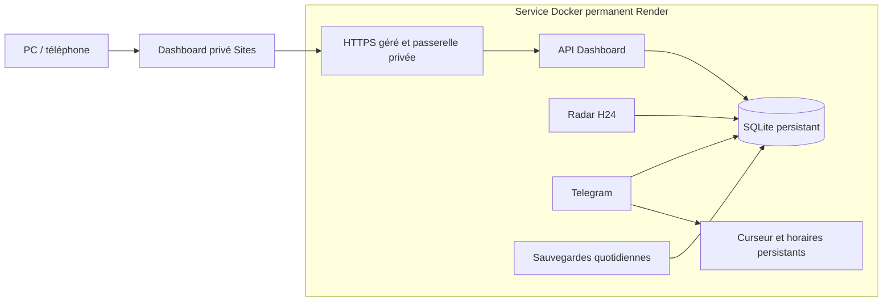

# Quitter un VPS sans perdre l’état du radar

Le Dashboard peut rester sur Sites. Le radar Python, l’écouteur Telegram, les
sauvegardes et l’API de suivi nécessitent un hébergement permanent. Le Worker de
Sites ne remplace pas un processus Python continu. Cette livraison prépare un
service Docker unique sur Render, avec disque persistant et HTTPS géré.

**État de livraison : préparé et testé localement ; aucune bascule de production
effectuée.** Un compte Render avec facturation et accès au dépôt est nécessaire.
L’offre gratuite ne convient pas au fonctionnement permanent avec disque.
`render.yaml` propose le plan `standard` et un disque de 10 Go ; vérifier le devis
actuel avant création. Adapter la capacité après mesure de la mémoire et du disque.
Les accès restreints de certains employeurs doivent être revérifiés depuis la
nouvelle adresse réseau ; changer d’hébergeur ne résout pas un CAPTCHA.

## Architecture et démarrage



Le disque `/app/data` contient un dossier restauré `state/config` et `state/data`.
Une seule instance est autorisée ; ne pas activer l’autoscaling ni les previews.
Les déploiements automatiques sont désactivés. Le verrou sur le disque protège
contre deux services sur ce même volume. **Il ne peut pas verrouiller un VPS
distinct : l’arrêt confirmé de l’ancien radar et de l’ancien écouteur est une
condition de bascule.**

Par défaut, `RADAR_MODE=standby` : seule la passerelle et `/healthz` fonctionnent.
Aucun scan, interrogation Telegram, création de base ou modification du suivi.
Le code ne crée pas une base vide pour masquer une restauration manquante.
L’état public de santé ne contient ni données personnelles ni secrets ; il
distingue explicitement `standby` et `active`.

En mode actif, le superviseur lance la passerelle, l’API, les sauvegardes, le radar
et Telegram. Si un processus termine, il arrête les autres et échoue pour que
l’hébergeur puisse relancer l’ensemble. Le signal d’arrêt est transmis à tous les
groupes de processus ; le délai plateforme de 60 secondes laisse finir l’arrêt.
La fraîcheur du radar entre dans la santé après une grâce initiale de 180 secondes.
Les échecs de portails restent des avertissements de couverture, distincts d’un
processus arrêté. Les processus API/sauvegarde/passerelle ne reçoivent pas le
jeton Telegram et ne peuvent pas envoyer d’alertes.

## Préparer la destination pendant que le VPS reste actif

1. Créer le compte Render et autoriser uniquement le dépôt nécessaire. Créer un
   Blueprint depuis la branche contenant cette livraison, après validation du
   coût. Conserver `RADAR_MODE=standby` et `RADAR_CUTOVER_CONFIRMED=false`.
2. Vérifier la construction de `Dockerfile.managed`, le montage persistant,
   l’écriture par l’utilisateur 10001 et `/healthz` en mode `standby`. Ne pas
   remplacer la base ni contourner un problème de permissions en lançant le radar
   avec des droits administrateur. Prévoir un redémarrage avec ce même disque.
3. Configurer les secrets dans Render, jamais dans Git : `TELEGRAM_BOT_TOKEN`,
   `TELEGRAM_CHAT_ID`, `DASHBOARD_PUBLIC_ORIGIN` (origine HTTPS du nouveau service),
   `DASHBOARD_PRIVATE_PREFIX` (chemin aléatoire de 32–128 caractères avec `/` des
   deux côtés), `DASHBOARD_GATEWAY_SECRET` (généré par le Blueprint). L’identifiant
   d’activation peut rester vide tant que le service est en attente.
4. Préparer un transfert **privé** de l’archive vers le disque de la destination
   depuis sa console/SSH ou un stockage privé. Ne jamais publier l’archive dans
   GitHub, les assets Sites, un commentaire, une URL publique ou un journal.
5. Recenser les chemins utilisés par la configuration de sources. Les sessions
   de navigateur, cookies, fichiers bruts et chemins externes ne sont pas copiés
   automatiquement ; traiter explicitement ces dépendances avant activation.

Le schéma du Blueprint est publié à
`https://render.com/schema/render.yaml.json` ; valider aussi le devis et la
configuration dans le compte cible. Les contrôles Docker locaux ne constituent
pas une validation d’un déploiement Render réel.

## Export final et restauration vérifiée

Réserver une courte interruption des écritures. Suspendre les écritures du
Dashboard à leur entrée HTTPS, puis arrêter **tous** les producteurs : radar,
écouteur Telegram, sauvegardes et API Dashboard. Désactiver les redémarrages
automatiques de l’ancienne pile pendant la bascule ; vérifier aussi les anciennes
tâches Windows. Ne pas utiliser `down -v`, purger les alertes, réinitialiser le
curseur ou recalculer les scores pendant ce transfert.

Avec l’environnement Python de la livraison, pointer `--config-dir` vers les
**trois fichiers réellement montés dans les conteneurs de production**, avec le
profil des sources activées. Ne pas remplacer le profil installé par le catalogue
générique du dépôt. Les exemples ci-dessous utilisent des chemins fictifs.

```bash
python scripts/migrate_state.py export /source/data/jobs.db /private/final-migration.zip --config-dir /source/runtime-config --source-stopped
python scripts/migrate_state.py verify /private/final-migration.zip
```

L’export échoue si un verrou connu reste pris. `--source-stopped` atteste un arrêt
opérationnel ; il ne détecte pas tous les écrivains possibles. Une sauvegarde
SQLite cohérente intègre les transactions WAL validées et les souhaits. Le bundle
ajoute les fichiers Telegram, le heartbeat, les trois YAML et l’historique de
santé. Chaque fichier est vérifié par SHA-256 ; schémas, intégrité, références et
liaisons Telegram sont contrôlés. Les fichiers `.env`, jetons et anciens verrous
ne sont pas collectés. L’archive reste privée, avec permissions 0600.

Restaurer sur le disque cible dans un dossier **nouveau** :

```bash
python /app/scripts/migrate_state.py restore /private/final-migration.zip /app/data/state
```

La restauration n’écrase aucun dossier existant et ne démarre aucun processus.
Elle produit un reçu privé dans `state/data/migration-receipt.json` et affiche
uniquement le résultat et l’identifiant d’activation. Comparer tous les contenus
de tables source/cible, les alertes envoyées et ambiguës, les historiques, les
révisions du suivi et des souhaits, le nombre de sources activées, ainsi que les
octets du curseur et du heartbeat. Garder une copie indépendante du bundle final
jusqu’à validation de la reprise et de la sauvegarde externe.

## Bascule

1. Vérifier que les anciens producteurs restent arrêtés et que la nouvelle base
   contient bien le dernier export figé. Définir `RADAR_ACTIVATION_ID` sur
   l’identifiant du reçu, `RADAR_CUTOVER_CONFIRMED=true`, puis `RADAR_MODE=active`.
   Conserver la même identité de bot et de conversation. Le démarrage refuse un
   reçu absent, une activation différente ou une liaison Telegram incohérente.
2. Vérifier `/healthz` actif, la progression du radar, les journaux et les
   sauvegardes. Vérifier `/statuts` une fois et les compteurs de sources, sans
   provoquer d’envoi rétroactif de toutes les offres.
3. Dans les **secrets** du site existant, remplacer uniquement
   `IMMORTAL_UPSTREAM_URL` par la nouvelle URL privée HTTPS. Invalider les caches
   R2 `radar-cache/v1` et `radar-cache/v2`, qui contiennent aussi les anciennes
   sessions chiffrées ; recharger le Dashboard. Ne pas supprimer les autres objets
   du bucket ni rendre le site public. Le lien Sites et le logo restent les mêmes.
4. Vérifier lecture, filtres, description complète, notes, souhaits et confirmation
   Postulé sur mobile, puis vérifier ces changements dans Telegram. Recharger et
   redémarrer le service cible pour confirmer la persistance. Contrôler l’absence
   de second écouteur et l’absence de réémission des alertes déjà traitées.
5. Configurer une copie chiffrée indépendante du disque/hébergeur et en tester la
   restauration. Les sauvegardes DB quotidiennes locales n’incluent pas le curseur
   Telegram ; elles ne remplacent pas un bundle final pris à l’arrêt ni une
   stratégie externe pour l’ensemble de l’état. Vérifier les snapshots de disque
   proposés par le fournisseur et leur rétention avant de leur faire confiance.
6. Observer au moins un cycle complet de collectes et les messages programmés.
   La suppression du VPS ne vient qu’après ces contrôles, la sauvegarde externe
   vérifiée et la décision de décommissionnement. Cette livraison ne supprime
   aucun serveur ni abonnement.

## Retour arrière

Avant toute activation de la cible et toute nouvelle écriture, il est possible de
remettre en route la pile source inchangée et son ancien accès.

**Après une seule nouvelle écriture ou tentative Telegram côté cible, la copie
VPS est ancienne.** Mettre les accès en maintenance, arrêter la cible, exporter
son état le plus récent avec le même outil et le restaurer dans un nouveau
dossier source. Valider la récupération, réorienter la configuration et le secret
Sites, invalider les caches, puis seulement redémarrer les anciens services.
Ne jamais réactiver une copie ancienne du curseur ou de la file d’alertes.

## Contrôles reproductibles

```bash
PYTHONPATH=src python -m pytest tests/test_managed_migration.py tests/test_cloud_runtime.py
docker build -f Dockerfile.managed -t immortal-trading:managed .
python scripts/smoke_managed.py immortal-trading:managed
```

Les essais utilisent uniquement des données synthétiques : tables et historiques
identiques après restauration, curseur identique, altération et chemins dangereux
refusés, absence d’écrasement, liaison bot vérifiée avant transport, démarrage en
attente, exclusion d’une seconde instance sur le même volume, arrêt propre et
persistance après redémarrage. Le smoke Docker interdit tout réseau externe.
